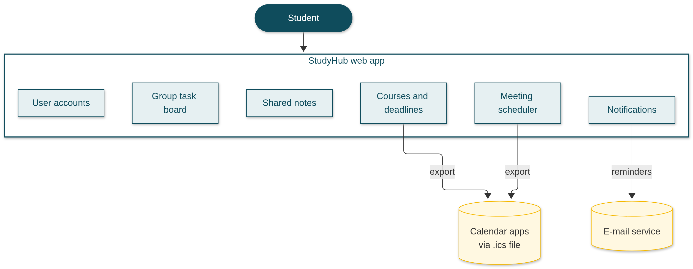

# Week 1: Introducing StudyHub — project vision

*By Ergens Hyso, Kristine Megrelishvili and Antonio Kanani*

You probably know the situation. It's Sunday evening, the group report is due on Monday, and somebody writes in the chat: "Wait, who was doing part three?" Nobody answers for an hour. Then three people answer at once, and all three of them thought it was someone else.

We have been in that chat. More than once. That's where **StudyHub** comes from.

## Project vision

| | |
|---|---|
| **Name** | **StudyHub** — a web app for student teams |
| **Useful function** | One place for courses, deadlines, tasks, meetings and group notes, so the team spends less time coordinating and more time on the actual work |
| **Objective (end of semester)** | A student team can run a group project in StudyHub without a separate spreadsheet, without endless "who's doing what?" messages, and without missing a deadline because nobody reminded anyone |

StudyHub does **not** replace Moodle and does not grade anyone. It helps small groups organize themselves.

## The problem

Group work itself is fine. Organizing it is the painful part. Deadlines sit in Moodle, tasks live in someone's head, notes are split across Google Docs, WhatsApp and a photo of a whiteboard, and finding a meeting time takes twenty messages. By the time everything is sorted out, half the energy for the actual work is gone.

## What we are building

In StudyHub you add your courses and deadlines, create a group with your teammates, and split the work into tasks. Every task has one owner, so "I thought you were doing it" is harder to use as an excuse. The dashboard shows what's due next across your courses and groups. When you need to meet, everyone enters when they are free and StudyHub suggests a time that works. Shared notes stay in one place instead of five apps.

**Who it is for:** university students in project groups — basically people like us. No training needed; the first screen should make sense within ten seconds.

## Subsystems

We split the app into **six subsystems**. Each one is small enough for one person to own in the team, and together they cover the whole product. This keeps the project manageable for one semester.

*Figure: the six subsystems inside StudyHub and the two outside systems they talk to.*

| Subsystem | What it does (function) | Objective |
|---|---|---|
| **User accounts** | Sign up, log in, profile, group membership | Every student and every group has its own secure space |
| **Courses and deadlines** | Add courses and due dates | No deadline sneaks up on the team unnoticed |
| **Group task board** | Tasks with one owner and status (to do, in progress, done) | Everyone sees who is doing what |
| **Meeting scheduler** | Members enter free times; StudyHub suggests a common slot | Replace long chat polls when scheduling meetings |
| **Shared notes** | Notes the whole group can read and edit | One place for meeting notes and decisions |
| **Notifications** | E-mail for sign-up, invitations, deadlines, tasks and meetings | Nobody has to chase the group by hand for every reminder |

## Dependencies on outside systems

StudyHub is **stand-alone**: it does not connect to Moodle or other university systems. We only rely on:

1. **E-mail service (SMTP)** — confirmations, group invitations and reminders.
2. **The student's calendar app (optional)** — export of deadlines and meetings as an **.ics** file (e.g. Google Calendar, Outlook). We do not call Google or Microsoft APIs in the first release.

## Assumptions

Every project rests on a few guesses. Ours:

- Study groups are **small** (about 2–6 people).
- Each student has **their own account**, a modern browser, internet and an e-mail address.
- Students are willing to **enter courses and deadlines themselves** (StudyHub is not fed automatically from Moodle).
- Teammates accept **sharing free times** with the group for scheduling.

If one of these turns out to be wrong, we will adjust the design — and we will say so in a later blog post.

## What we are not building (scope)

One semester goes by fast, so we decided early what to leave out:

- Not a learning management system — lecturers do not upload material or grades here.
- No built-in video calls — groups can paste a link to Zoom, Meet or whatever they already use.
- No contribution tracking or grading — StudyHub supports the team; it does not watch or score members.

More detail lives in our [Software Requirements Specification](../SRS.md) on GitHub.

## Who we are

We are three computer science exchange students at DHBW Karlsruhe:

- **Antonio Kanani** — keeps the group organized; if there is a plan, he probably wrote it. *University of Vlora, Albania*
- **Ergens Hyso** — backend and problem-solving in Python or Java. *University of Vlora, Albania*
- **Kristine Megrelishvili** — UI/UX and making sure people understand the product. *Georgia*

## Next week

Next week we pick our **technology stack**, agree **roles**, and set up GitHub and the project board. That will be our Week 2 post.

## Reflection on AI use

Because this is a new repository we created all new files and decided to storage each file under a specific name to make it easier to find everything. We also gathered with each other and kept our original ideas of our project, we didnt used AI on the git this week but we used Cursor AI to fix the theme on our wordpress page.
