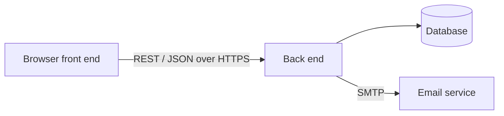

# Week 2: Our Team, Technology and Project Setup

*By Ergens Hyso, Kristine Megrelishvili and Antonio Kanani*

Last week we introduced the idea behind StudyHub. This week we started turning the idea into a project: we split the work, chose how StudyHub will be built and set up our repository.

## Who does what

| Team member | Responsibility | First work |
| :---- | :---- | :---- |
| Ergens Hyso | Full-stack development and architecture | Sets up the project structure, the in-memory model and the automated tests |
| Kristine Megrelishvili | UI/UX design and planning | Plans the screens and keeps the WordPress journal readable for the course |
| Antonio Kanani | Database and workflow | Designs how the data is stored and keeps the board and the weekly plan up to date |

We checked these roles together. Ergens starts with architecture and code, Kristine with how people will use StudyHub and how we present the work, and Antonio with the data model and the day-to-day workflow of the team.

## How StudyHub will be built

StudyHub is a stand-alone web application with three parts:

- a **front end** that runs in the browser (current Chrome, Firefox, Safari and Edge) and works on desktop and on phones,
- a **back end** on a server, which the front end talks to through a REST interface with JSON over HTTPS,
- a **database** that stores accounts, courses, groups, tasks, meetings and notes.

StudyHub doesn't depend on any university system. The only external service is an **email service** (SMTP) for confirmation, invitation and reminder emails. Later, deadlines and meetings can be exported as calendar files in the iCalendar format.

For the first release we chose a small stack that we can finish in one semester:

- **Front end:** React in the browser, so Kristine can build clear screens that also work on phones.
- **Back end:** Node.js with a REST API, because our tests already run on Node and the whole team can read JavaScript.
- **Database:** PostgreSQL, so Antonio can store accounts, courses, groups, tasks and meetings in clear tables.

We keep the email service as SMTP only. No university systems and no extra APIs in the first release.

## How we work together

We agreed on a few rules from the start:

- **Everything lives in Git.** Our code and our documentation are in one GitHub repository. Documentation is written in Markdown, so we can review it like code.
- **Small steps.** We work in small changes instead of one big upload at the end of the week.
- **Review before merging.** Another team member reviews each change before it goes into the main branch.
- **Automated tests.** The core functions get automated tests that run before changes are merged.
- **Privacy from the start.** StudyHub stores personal data, so it follows the GDPR. Passwords are stored only as salted hashes and we only store data we really need.

We plan and track the work in **GitHub Projects** in the same repository as the code. Issues and pull requests are linked to the board, so the plan and the code stay in one place. We meet about two or three times a week, in person when we can and online when we cannot, and we leave short notes after each meeting.

## Next week

Next week we write down exactly what StudyHub must do: our Software Requirements Specification and the overall use case diagram.

## Reflection on AI use

For this week update our team used Cursor AI as an assistant to help structure the layout and refine the text for clarity. We also used it to summarize the reasoning behind our technical choices. All project management decisions, technology selections, and task distributions were made entirely by our team.
