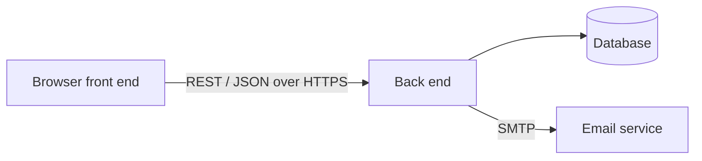

# Week 2: Our Team, Technology and Project Setup

*By Ergens Hyso, Kristine Megrelishvili and Antonio Kanani*

Last week we introduced the idea behind StudyHub. This week we started turning the idea into a project: we split the work, chose how StudyHub will be built and set up our repository.

## Who does what

| Team member | Responsibility |
| :---- | :---- |
| Ergens Hyso | Full-stack development and architecture |
| Kristine Megrelishvili | UI/UX design and planning |
| Antonio Kanani | Database and workflow |

> **To do (team):** check these roles and add what each person works on first.

## How StudyHub will be built

StudyHub is a stand-alone web application with three parts:

- a **front end** that runs in the browser (current Chrome, Firefox, Safari and Edge) and works on desktop and on phones,
- a **back end** on a server, which the front end talks to through a REST interface with JSON over HTTPS,
- a **database** that stores accounts, courses, groups, tasks, meetings and notes.

StudyHub doesn't depend on any university system. The only external service is an **email service** (SMTP) for confirmation, invitation and reminder emails. Later, deadlines and meetings can be exported as calendar files in the iCalendar format.

> **To do (team):** add the languages and frameworks you choose for the front end, the back end and the database, and one sentence each on why.

## How we work together

We agreed on a few rules from the start:

- **Everything lives in Git.** Our code and our documentation are in one GitHub repository. Documentation is written in Markdown, so we can review it like code.
- **Small steps.** We work in small changes instead of one big upload at the end of the week.
- **Review before merging.** Another team member reviews each change before it goes into the main branch.
- **Automated tests.** The core functions get automated tests that run before changes are merged.
- **Privacy from the start.** StudyHub stores personal data, so it follows the GDPR. Passwords are stored only as salted hashes and we only store data we really need.

> **To do (team):** add the tool you use to plan and track work (for example GitHub Projects, Trello or Jira) and how often you meet.

## Next week

Next week we write down exactly what StudyHub must do: our Software Requirements Specification and the overall use case diagram.

## Reflection on AI use

> **To do (team):** write this section yourselves, in your own words. Do not generate it with AI.
