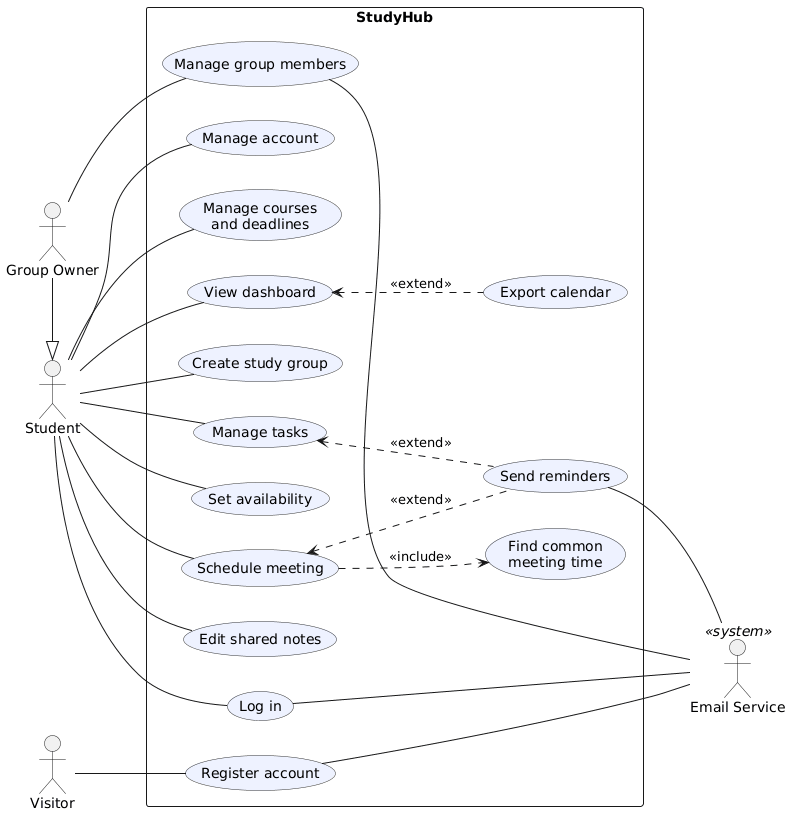

# Week 3: From Idea to Requirements, Our SRS and Use Case Diagram

*By Ergens Hyso, Kristine Megrelishvili and Antonio Kanani*

Last week we split the work and chose how StudyHub will be built. This week we wrote down exactly **what** StudyHub must do. We did that in two documents: a Software Requirements Specification (SRS) and an overall use case diagram.

## Our SRS

Our [SRS](../SRS.md) follows the RUP template, with IEEE 830 as guidance. It has four parts:

1. **Introduction:** purpose, scope, definitions and references.
2. **Overall description:** what kind of product StudyHub is, its main functions, its users, constraints and assumptions.
3. **Specific requirements:** what the system must do (functionality) and how well it must do it (usability, reliability, performance, supportability, design constraints, interfaces, licensing and standards).
4. **Supporting information.**

## Choosing the scope for this semester

We can't build everything in one semester, so we gave every group of requirements a priority. The first release has everything marked *High*. *Medium* and *Low* come later if time allows.

| Priority | Requirements |
| :---- | :---- |
| High | Accounts, courses and deadlines, study groups, tasks, dashboard |
| Medium | Availability and meetings, shared notes, email notifications |
| Low | Calendar export (iCalendar) |

We also wrote down the quality we expect, with numbers we can check later. Some examples:

- A new user can register, create a group and add a first task within **5 minutes** without help.
- **95 %** of pages and actions respond within **2 seconds**.
- The interface works on phones from **360 px** wide and follows **WCAG 2.1 level AA**.

## The overall use case diagram

The diagram shows **who** can do **what** in StudyHub:

- **Actors** are roles, not people. A *Visitor* can only register. A *Student* uses most of StudyHub. A *Group Owner* "is a" Student who can also manage the members of a group. The *Email Service* is an external system, so it is an actor too.
- **Use cases** are named as goals, a verb plus an object: *Manage tasks*, *Schedule meeting*, *View dashboard*.
- **«include»** means one use case always uses another: *Schedule meeting* always includes *Find common meeting time*.
- **«extend»** means optional extra behaviour: *Send reminders* extends *Manage tasks* and *Schedule meeting*, and *Export calendar* extends *View dashboard*.

## What StudyHub will not do

Writing the SRS also meant deciding what is out of scope. StudyHub is not a learning management system like Moodle, has no video calls and does no grading.

## Next week

The diagram only shows that a use case exists, not how it works. Next week we take two use cases (*Create a task* and *Schedule meeting*) and write a detailed specification for each.

## Reflection on AI use

This week we used Cursor AI to help us tidy the SRS wording and to check that the use case diagram matched the text. The priorities, the quality goals and what we leave out of scope were decided by the team in our meetings. We read every section again ourselves before we put it in the repository.
