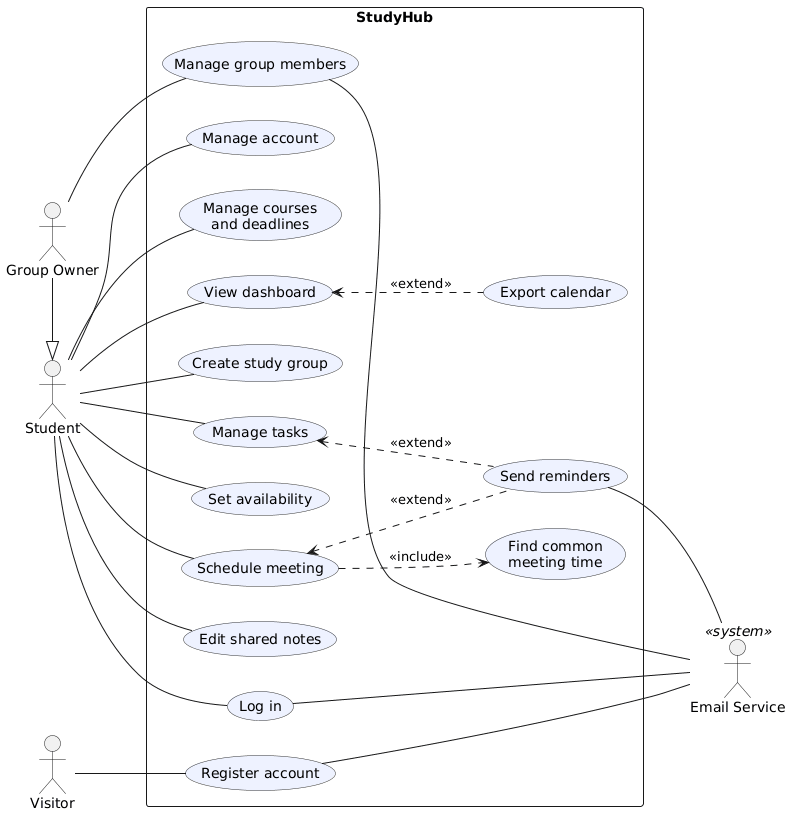
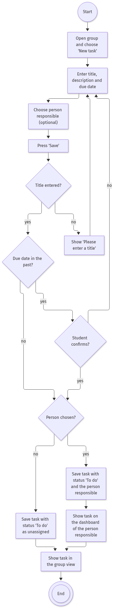
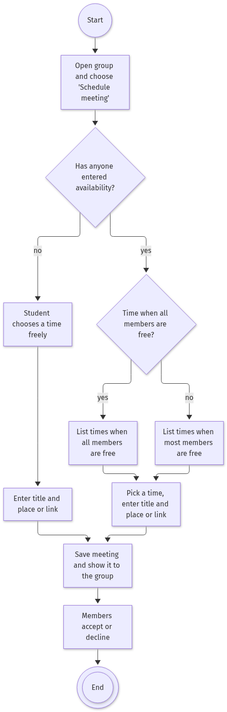

# Week 4: From Use Case Diagram to Use Case Specification

*By Ergens Hyso, Kristine Megrelishvili and Antonio Kanani.*

## Where we are on the road

So far our project went like this:

1. **Vision:** group projects are chaotic, so we put courses, deadlines, tasks, meetings and notes into one app.
2. **Overall use case diagram:** the circles and stick figures that show *who* can do *what*.
3. **SRS:** the [requirements document](../SRS.md), where we chose the scope for this semester.

The diagram has a weakness. Take **Schedule meeting**: all we did was draw a circle, name it, and say a group member can use it. We don't yet know *how* it works. The use case specification is the next step, where we drill deeper.

## The "throw it over the wall" test

Our lecturer gave us a mental test. Imagine your development team sits in another country. You send them your specification in the evening and go to sleep. When you wake up, will you get what you wanted?

Today the team on the other side may well be an AI, but the test is the same: **can someone else, or something else, build the feature from the text alone, without asking us a single question?** If the answer is no, the specification isn't finished.

## A reminder: what makes a good use case

- **Actors are roles, not people.** "Student" or "Group Owner", not "Kristine". Actors can be people, systems or devices.
- **A use case is named as a goal:** a verb plus an object, like *Manage tasks* or *Schedule meeting*.
- **Only visible things count.** A use case describes what is meaningful to the actor, not our internal database tables.
- **Notation:** we use standard UML, with stick figures, ovals, a system boundary, «include», «extend» and "is a" arrows. We don't change the standard for our own project.

*Our overall use case diagram. The Group Owner "is a" Student; Schedule meeting always includes Find common meeting time; Export calendar and Send reminders are optional extensions.*

## Not a waterfall

One more lesson from the lecture: we don't finish all the specifying first and only then build. We specify, learn our technology and, from next week, start testing the user interface, all at the same time. That is how the RUP workflows are meant to be used, and it is why we are already exploring our tech stack while we write specifications.

## What a use case specification contains

For each use case we write down:

| Part | Question it answers |
| :---- | :---- |
| Goal | What does the actor want to achieve? |
| Actors | Who is involved? |
| Preconditions | What must be true before it starts? |
| Main flow | What happens, step by step, when everything goes well? |
| Alternative flows | What happens when something differs or goes wrong? |
| Postconditions | What is true afterwards? |

## Our two use case specifications

- **[Create a task](../use-cases/create-task.md):** a group member puts a piece of work on the board and says who does it. Alternative flows cover a missing title, a task without a person responsible and a due date in the past.
- **[Schedule meeting](../use-cases/schedule-meeting.md):** a group finds a time that works for everyone. It always includes the use case *Find common meeting time*. Alternative flows cover no time that works for everyone and nobody having entered availability.

Each specification also has an activity diagram that shows every path through the use case.

*Activity diagram for Create a task.*

*Activity diagram for Schedule meeting.*

## What we learned

Writing the specifications showed us gaps in our SRS that the diagram hid. We had never decided what StudyHub suggests when no time works for everyone, or what a task without an owner looks like. It is better to find that out now than when we are coding.

The next test is the "over the wall" one: could another team, or an AI, build these two use cases from our text alone? We will check this ourselves and adapt the specifications until the answer is yes.

## Next week

We start thinking about **testing the user interface**. Our specifications give us a starting point, because every alternative flow is a test case waiting to be written.

*Documents for this project live in our Git repository: the SRS, the use case diagram and the use case specifications are in the `docs/` folder.*

## Reflection on AI use

> **To do (team):** write this section yourselves, in your own words. Do not generate it with AI.
