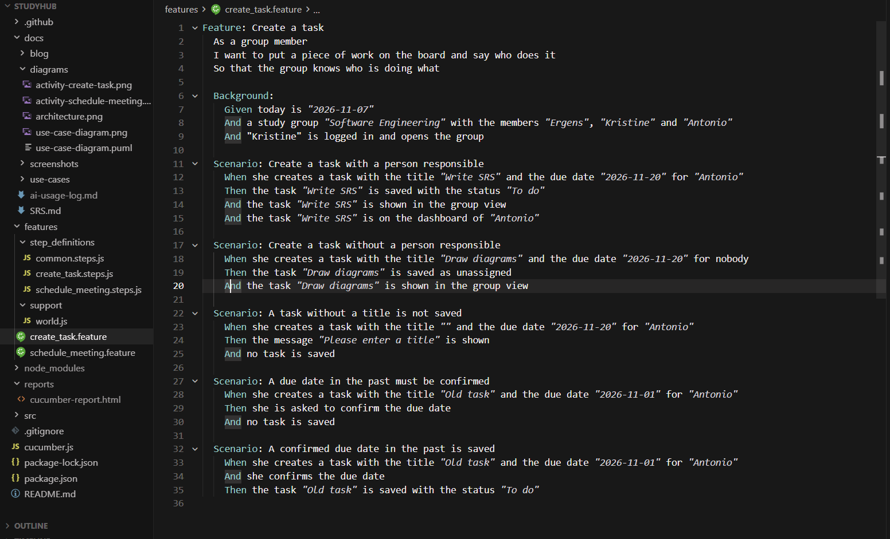
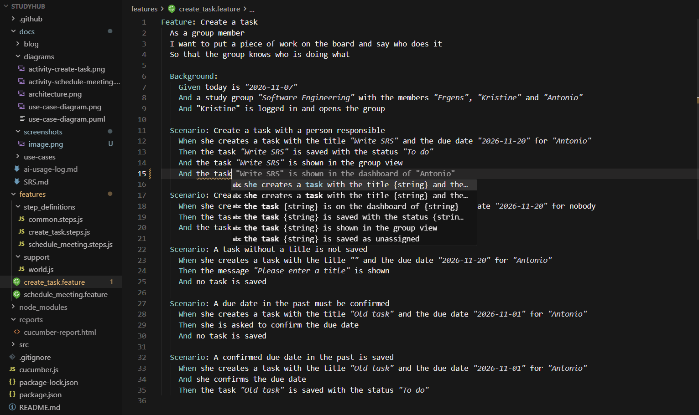

# Week 5: Testing StudyHub with Cucumber

*By Ergens Hyso, Kristine Megrelishvili and Antonio Kanani*

This week we looked at testing. Our StudyHub use cases are now written as **Gherkin feature files** that a computer can run, using **CucumberJS**. We wrote two feature files, one for **Create a task** and one for **Schedule meeting**. Each has several scenarios, and all of them run and pass. The feature files, the step definitions and the code they test are all in our Git repository, so anyone can run them:

- [`features/create_task.feature`](https://github.com/kristine-coder/studyhub/blob/main/features/create_task.feature)
- [`features/schedule_meeting.feature`](https://github.com/kristine-coder/studyhub/blob/main/features/schedule_meeting.feature)
- [Step definitions](https://github.com/kristine-coder/studyhub/tree/main/features/step_definitions)

## What is Gherkin and BDD?

**BDD (behaviour-driven development)** means we describe what the software should do in plain language *before* we build it. **Gherkin** is the language for that. Everybody in the team can read it, including people who don't write code, and a tool such as Cucumber can run it as an automated test.

A feature file looks like this (taken from [`features/schedule_meeting.feature`](https://github.com/kristine-coder/studyhub/blob/main/features/schedule_meeting.feature)):

```gherkin
Feature: Schedule meeting
  As a group member
  I want to schedule a meeting at a time that works for everyone
  So that the whole group can meet without comparing timetables by hand

  Background:
    Given a study group with the members "Ergens", "Kristine" and "Antonio"
    And "Kristine" opens the group and chooses "Schedule meeting"

  Scenario: StudyHub lists the times when all members are free
    Given "Ergens" is free on "Mon 10:00" and "Tue 14:00"
    And "Kristine" is free on "Mon 10:00" and "Tue 14:00"
    And "Antonio" is free on "Tue 14:00" and "Wed 09:00"
    When StudyHub looks for a common meeting time
    Then the suggested times are "Tue 14:00"
    And all 3 members are free at the suggested times
```

| Keyword | Meaning |
| :---- | :---- |
| **Feature** | The use case that is tested, with the actor and the goal |
| **Background** | Steps that run before every scenario in the file |
| **Scenario** | One concrete example of the use case |
| **Scenario Outline** | One scenario that runs once for each row of an **Examples** table |
| **Given** | The starting situation |
| **When** | What the user does |
| **Then** | What we expect to happen |
| **And** | Adds another step to Given, When or Then |

Each line is connected to a small piece of code, a **step definition**. The sentence is the specification, the step definition is the test, and so the documentation always shows whether the requirement still works. It is living documentation.

## The feature files in our IDE

We installed the official Cucumber extension in our IDE. It highlights the Gherkin keywords in our feature files:



It also suggests steps from our step definitions while we type, so we reuse existing steps instead of writing new ones with slightly different wording:



## Our two use cases

For each use case we have a narration, an activity diagram and a feature file. The full details are in our use case specifications for [Create a task](../use-cases/create-task.md) and [Schedule meeting](../use-cases/schedule-meeting.md).

### Create a task

The [activity diagram](../use-cases/create-task.md#activity-diagram) has these paths:

| Path in the activity diagram | Scenario |
| :---- | :---- |
| Title and person entered | Create a task with a person responsible |
| Title entered, nobody chosen | Create a task without a person responsible |
| Title missing | A task without a title is not saved |
| Due date in the past, not confirmed | A due date in the past must be confirmed |
| Due date in the past, confirmed | A confirmed due date in the past is saved |

```gherkin
Scenario: A task without a title is not saved
  When she creates a task with the title "" and the due date "2026-11-20" for "Antonio"
  Then the message "Please enter a title" is shown
  And no task is saved
```

### Schedule meeting

The [activity diagram](../use-cases/schedule-meeting.md#activity-diagram) has these paths:

| Path in the activity diagram | Scenario |
| :---- | :---- |
| A time works for all members | StudyHub lists the times when all members are free |
| No time works for everyone | No time works for everyone |
| Nobody has entered availability | Nobody has entered availability |
| Meeting saved and shown to the group | The meeting is shown to the whole group |
| Members answer the invitation | Members accept or decline the meeting (a *Scenario Outline* with 2 examples) |

```gherkin
Scenario: No time works for everyone
  Given "Ergens" is free on "Mon 10:00" and "Tue 14:00"
  And "Kristine" is free on "Mon 10:00" and "Wed 09:00"
  And "Antonio" is free on "Thu 16:00" and "Fri 12:00"
  When StudyHub looks for a common meeting time
  Then the suggested times are "Mon 10:00"
  And StudyHub shows that 2 of 3 members are free
```

Our specification first only said that StudyHub shows the times "when most members are free". That is not exact enough for a test, so we added a business rule to the [specification](../use-cases/schedule-meeting.md#business-rules): StudyHub shows the times when the largest number of members are free, and how many of them that is.

## Running the tests

We use **CucumberJS** with Node.js. After `npm install`, this is the result of `npm test`:

```text
11 scenarios (11 passed)
66 steps (66 passed)
```

Cucumber also writes an HTML report to `reports/cucumber-report.html`. The tests also run automatically on GitHub (GitHub Actions) every time someone pushes to the repository.

StudyHub itself doesn't exist yet, so for now our step definitions test a small in-memory model of the app in the [`src/`](https://github.com/kristine-coder/studyhub/tree/main/src) folder. Once we have a real interface, we change only the step definitions, not the feature files. The scenarios stay the same.

## What we learned

> **To do (team):** write in your own words what you learned from writing and running the tests.

## Reflection on AI use

> **To do (team):** write this section yourselves, in your own words. Do not generate it with AI.
