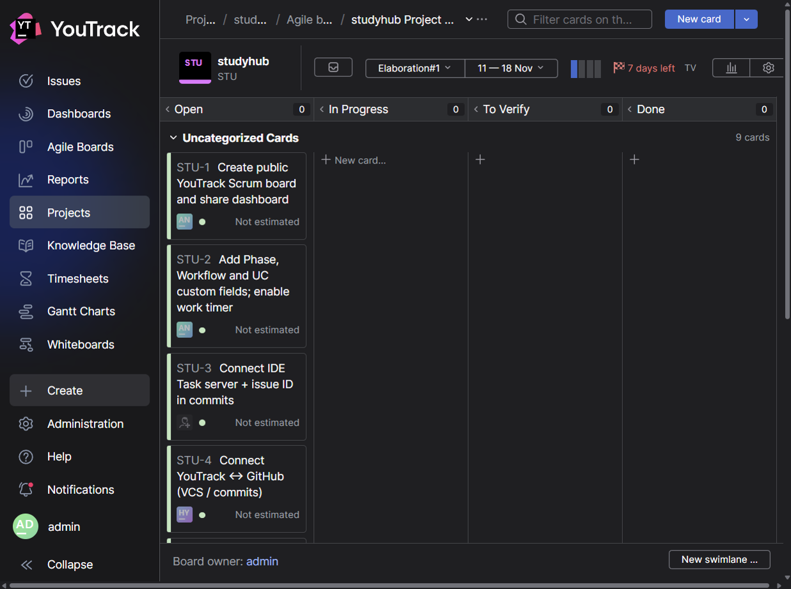
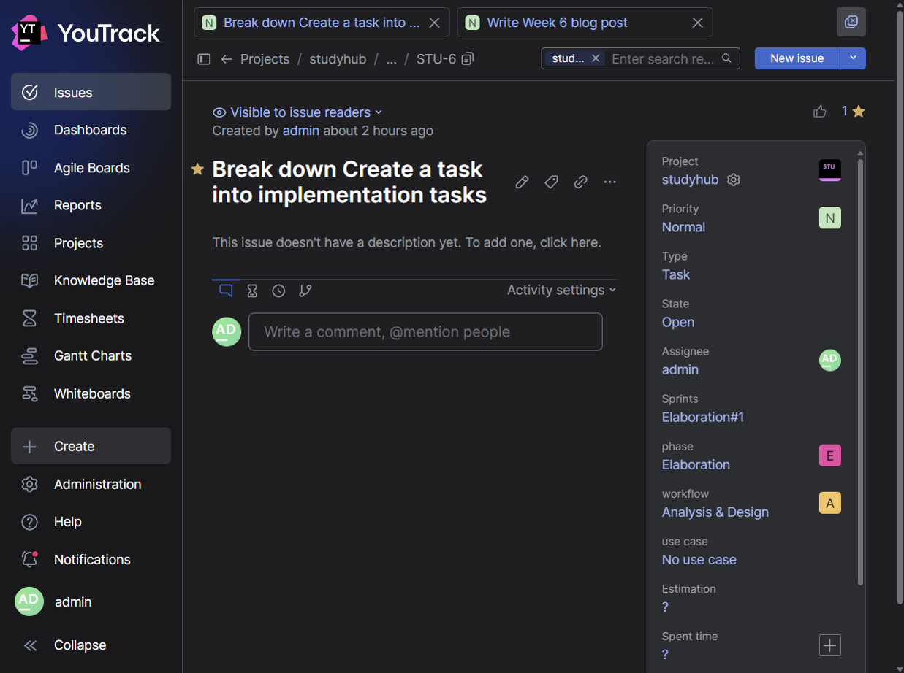
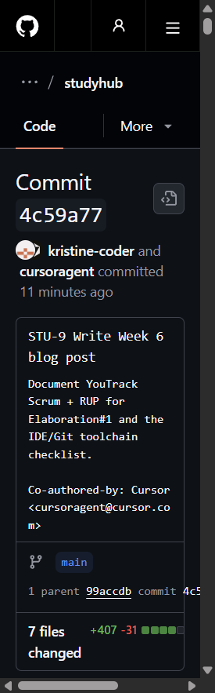
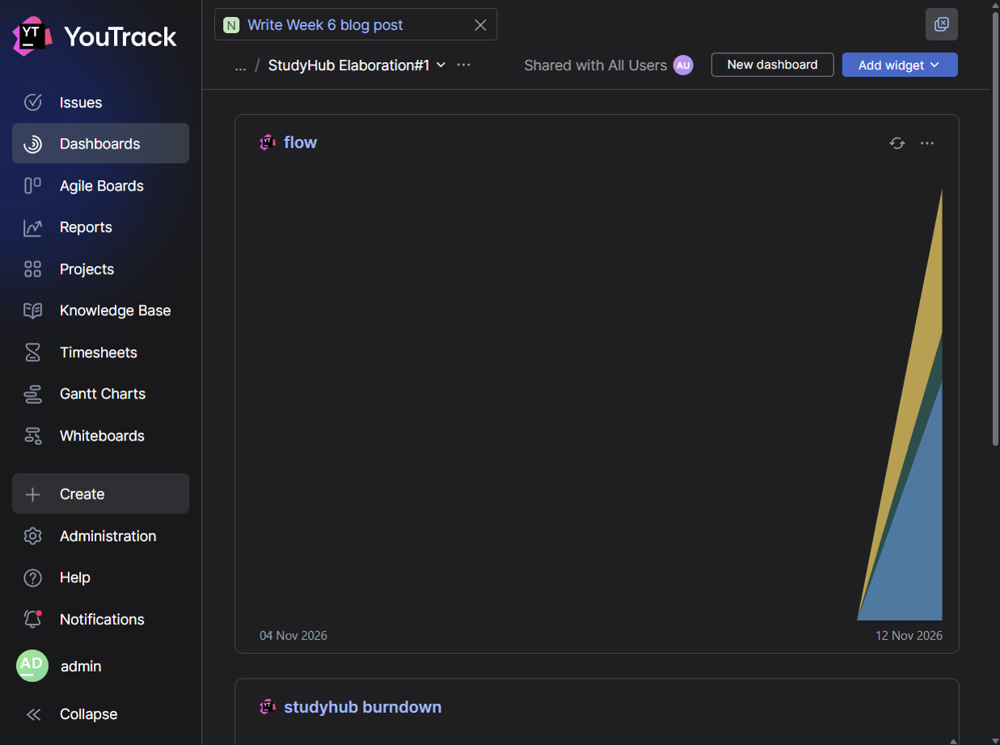
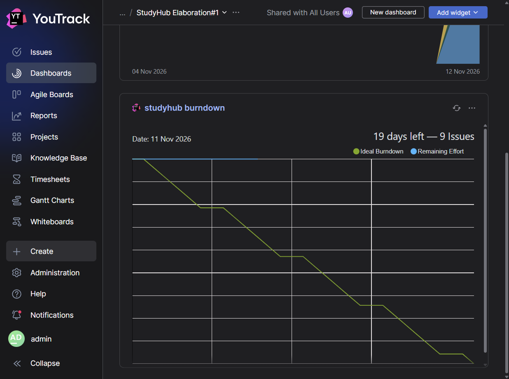

# Week 6: Running StudyHub as a Scrum project with YouTrack and RUP

*By Ergens Hyso, Kristine Megrelishvili and Antonio Kanani*

## Introduction: from documents to a managed project

During the first five weeks we worked mostly on documents: the project idea, the SRS, two use case specifications with activity diagrams, and Gherkin feature files with Cucumber tests. In RUP terms that was our **Inception** work. Its goal is to understand the scope and decide that StudyHub is worth building.

This week we move into **Elaboration**. By the midterm we need the Lifecycle Architecture Milestone: proof that our React / Node.js / PostgreSQL stack can carry the product. To get there we need more than good documents. We need to plan, track and measure the work. That is why Week 6 is about project management: a public Scrum board, RUP tags, time tracking, and a chain from the IDE to GitHub.

## Our project management tool: YouTrack

The grading criteria ask for **YouTrack**, so we use YouTrack as our Scrum tool. Earlier we kept a light plan in GitHub Projects; that was useful for Week 2, but it does not give us the public board, RUP custom fields, burn-down and time reports this assignment needs. YouTrack does.

Our public Scrum board (project key **STU**):

[StudyHub agile board](https://kristine2473.youtrack.cloud/projects/STU/agiles/204-1/current)

We granted a read-only role (**Issue Reader**) so people outside the team can open the board without edit rights.

Every issue will look like `STU-12`. That ID must appear in commit messages and pull request titles.

## Combining Scrum with RUP

Scrum tells us how to work in short iterations. RUP tells us what kind of work we are doing and in which phase we are. Every task on the board carries:

| Field | Values we use | Why |
| :---- | :---- | :---- |
| **Phase** | `Inception`, `Elaboration` | RUP phase |
| **Workflow** | `Requirements`, `Analysis & Design`, `Implementation`, `Test`, `Project Management` | RUP workflow |
| **Use case** | `UC-CreateTask`, `UC-ScheduleMeeting`, or empty | only when the task belongs to a use case |

Every sprint task also has one **assignee** and an **Estimated time** value. Tasks such as setting up YouTrack or writing this blog have no use-case tag; they still have Phase and Workflow (usually Project Management).

When a task is relevant to a use case we also keep the link clear (tag or parent user story), so midterm reports can group time by UC.

## Sprint naming and history

Sprints are named after the RUP phase, as required:

| Sprint | Dates | Goal |
| :---- | :---- | :---- |
| Inception#1 … Inception#5 *(optional backfill)* | Weeks 1–5 | idea, stack, SRS, UC specs, Cucumber |
| **Elaboration#1** | 11–18 Nov 2026 | public board, toolchain, architecture confirm, UC breakdown |
| Elaboration#2 … Elaboration#5 | later | design and implementation toward the midterm |

We do not need a perfect epic / story / subtask tree yet. We do need Elaboration#1 to exist with dates, so the first burn-down report has a start and an end.

Sprint **Elaboration#1** runs **11–18 Nov 2026**. The first burn-down is on our dashboard (link below).

## Elaboration#1: what is on the sprint

The first Elaboration sprint focuses on the technical foundation and on turning our two use cases into tracked work:

| Task | Assignee | Workflow | Phase | UC | Estimate |
| :---- | :---- | :---- | :---- | :---- | :---- |
| Create public YouTrack Scrum board and share dashboard | Antonio | Project Management | Elaboration | — | 3h |
| Add Phase, Workflow and UC custom fields; enable work timer | Antonio | Project Management | Elaboration | — | 2h |
| Connect IDE Task server + issue ID in commits | Ergens | Project Management | Elaboration | — | 2h |
| Connect YouTrack ↔ GitHub (VCS / commits) | Ergens | Project Management | Elaboration | — | 2h |
| Confirm React / Node.js / PostgreSQL skeleton plan | Ergens | Analysis & Design | Elaboration | — | 3h |
| Break down *Create a task* into implementation tasks | Kristine | Analysis & Design | Elaboration | UC-CreateTask | 3h |
| Break down *Schedule meeting* into implementation tasks | Antonio | Analysis & Design | Elaboration | UC-ScheduleMeeting | 3h |
| Keep Cucumber tests green on CI | Ergens | Test | Elaboration | UC-CreateTask | 2h |
| Write Week 6 blog post | Kristine | Project Management | Elaboration | — | 3h |

Sprint **Elaboration#1** (11–18 Nov 2026) now holds the foundation tasks above, with Phase, Workflow and sprint assignment on the board:

Example issue fields (Phase / Workflow on the right):

If the sprint looks overloaded for one person, we move unfinished work to Elaboration#2 instead of faking a green burn-down. Clean charts are not required yet; honest estimates and tags are.

## Time tracking

Estimating is only half of the work. We also log the time we actually spend, so we can compare estimates with reality and produce the midterm reports:

1. time spent **per use case**,
2. time spent **per person**,
3. time spent **per RUP workflow**.

In YouTrack we enable the **In Progress Work Timer** workflow. Starting a task from the IDE starts the timer; finishing the task stores spent time on the issue.

## Integration with the IDE and GitHub

The goal is one chain:

1. configure **Settings → Tools → Tasks → Servers** with the YouTrack URL and a permanent token,
2. use **Start Task** so the issue moves to In Progress and the timer starts (and optionally a branch is created),
3. put the issue ID in the commit message and the pull request title, for example `STU-9 Write Week 6 blog post`,
4. see the commit linked on the YouTrack issue (VCS integration).

WebStorm is already connected to `https://kristine2473.youtrack.cloud`; **Open Task** lists our `STU-…` issues, and changelist names use `${id} ${summary}`. YouTrack **Version Control** is linked to GitHub `kristine-coder/studyhub`, so commits that mention an issue ID can appear on that issue.

GitHub commit that references the blog task:

> **Team action:** add a WebStorm Task server screenshot (token hidden).

## Dashboard and reports

We create a shared dashboard for Elaboration#1. It should include at least:

- a **burn-down** for the sprint dates,
- a chart of work by **RUP workflow over time** (cumulative flow by workflow colours on the y-axis of time — not only a flat list of tasks).

Share the dashboard: **all users** can view (no edit); **team members** can edit. Grant **Issue Reader** so people outside the team can open the public board without an invite.

The Elaboration#1 dashboard includes the sprint **burndown** and a **cumulative flow** chart coloured by RUP **Workflow** (not by task status):

[StudyHub Elaboration#1 dashboard](https://kristine2473.youtrack.cloud/dashboard?id=177-3)

The dashboard is shared so All Users can view it:

## Proof we follow the method

This post is the written proof. The live proof is the public YouTrack board: sprints named `Elaboration#…`, tasks with assignees and estimates, Phase / Workflow / UC tags, time spent, and commits that carry the issue ID.

## What is not expected yet

We do not need a perfect burn-down, and we do not need a full epic / story / subtask hierarchy. We do need the sprint, the assigned and estimated tasks, and the RUP tags.

## What’s next

In Elaboration#2 we take the breakdown of *Create a task* and *Schedule meeting* and start the real implementation against the architecture we confirm this week.

## Questions for you

- Do you also use YouTrack, or did you stay on Jira / GitHub Projects?
- How did you make the board readable for people outside the team?
- Did the IDE → YouTrack → GitHub chain work on the first try?

## Reflection on AI use

We used Cursor AI to turn the grading criteria and another team’s Week 6 structure into a StudyHub checklist. The choice of YouTrack, the sprint name Elaboration#1, the task list and who owns each task are team decisions. Screenshots and live board links will be added after the YouTrack project exists.
