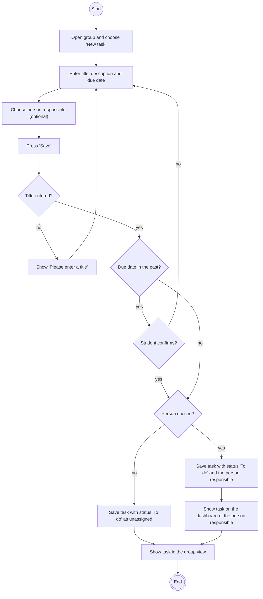

# Use case: Manage tasks (create a task)

|  |  |
| :---- | :---- |
| **Goal** | A group member wants to put a piece of work on the board and say who does it. |
| **Actor** | Student (group member) |
| **Preconditions** | The student is logged in and is a member of the group. |
| **Postconditions** | The task exists and every group member can see it. |
| **Tests** | [`features/create_task.feature`](../../features/create_task.feature) |

## Main flow

1. The student opens the group and chooses "New task".
2. The student enters a title, an optional description and a due date.
3. The student chooses who is responsible from the group members.
4. The student presses "Save".
5. The system saves the task with the status *To do*.
6. The system shows the task in the group view and on the dashboard of the person responsible.
7. The person responsible gets a reminder email (optional extension *Send reminders*).

## Alternative flows

- *3a. Nobody chosen:* the task is saved as "unassigned".
- *5a. Title is missing:* the system shows "Please enter a title" and does not save.
- *5b. Due date in the past:* the system asks the student to confirm. If the student confirms, the task is saved. If not, nothing is saved and the student can change the date.

## Activity diagram

