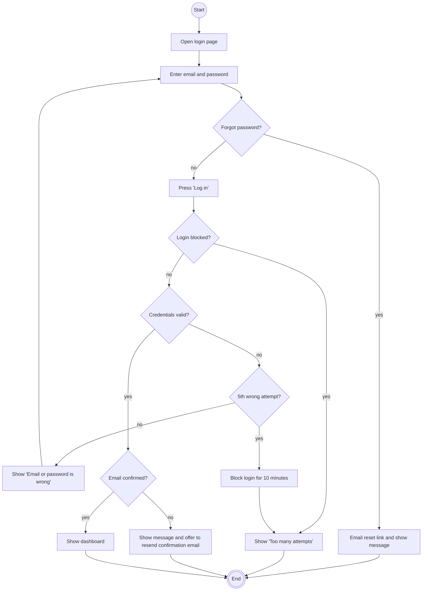

# Use case: Log in

|  |  |
| :---- | :---- |
| **Goal** | A registered student wants to get into their StudyHub account. |
| **Actor** | Student |
| **Preconditions** | The student has an account and is not logged in. |
| **Postconditions** | The student is logged in and sees their dashboard. |
| **Tests** | [`features/log_in.feature`](../../features/log_in.feature) |

## Main flow

1. The student opens the StudyHub login page.
2. The student enters their email address and password.
3. The student presses "Log in".
4. The system checks that login is not blocked for this account.
5. The system checks the email and password.
6. The system checks that the email address is confirmed.
7. The system opens the student's dashboard.

## Alternative flows

- *2a. Forgot password:* the student chooses "Forgot password" and enters their email address. The system shows "If an account exists for this email, we have sent a reset link." and emails a reset link.
- *4a. Login is blocked:* the system shows "Too many attempts. Please try again in 10 minutes." This also happens when the password is correct. The student stays on the login page.
- *5a. Wrong email or password:* the system shows "Email or password is wrong" without saying which one, and the student stays on the login page.
- *5b. Fifth wrong password in a row:* the system blocks login for this account for 10 minutes and shows "Too many attempts. Please try again in 10 minutes."
- *6a. Email address not confirmed:* the system shows "Please confirm your email address first." and offers to send the confirmation email again.

## Business rules

- Wrong attempts are counted per account. A successful password check resets the count to zero.
- After 10 minutes the block ends and the count starts again from zero.
- The "Forgot password" message is the same whether or not the email belongs to an account, so nobody can find out which emails are registered.

## Activity diagram

