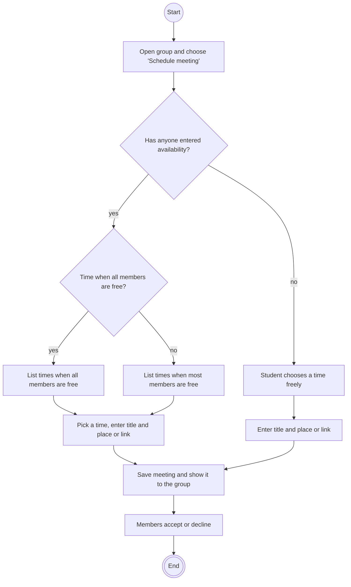

# Use case: Schedule meeting

|  |  |
| :---- | :---- |
| **Goal** | A group wants to meet at a time that works for everyone. |
| **Actor** | Student (group member) |
| **Preconditions** | The student is logged in and is in the group. |
| **Postconditions** | The meeting is visible to the whole group, with who has accepted. |
| **Tests** | Not written yet (priority *Medium* in the [SRS](../SRS.md)). |

## Main flow

1. The student opens the group and chooses "Schedule meeting".
2. The system finds the times when all members are free (included use case *Find common meeting time*) and lists them.
3. The student picks a time and enters a title and a place or link.
4. The system saves the meeting and shows it to the group.
5. Members accept or decline.

## Alternative flows

- *2a. No time works for everyone:* the system shows the times when most members are free.
- *2b. Nobody has entered availability:* the system asks the student to choose a time freely.

## Activity diagram

